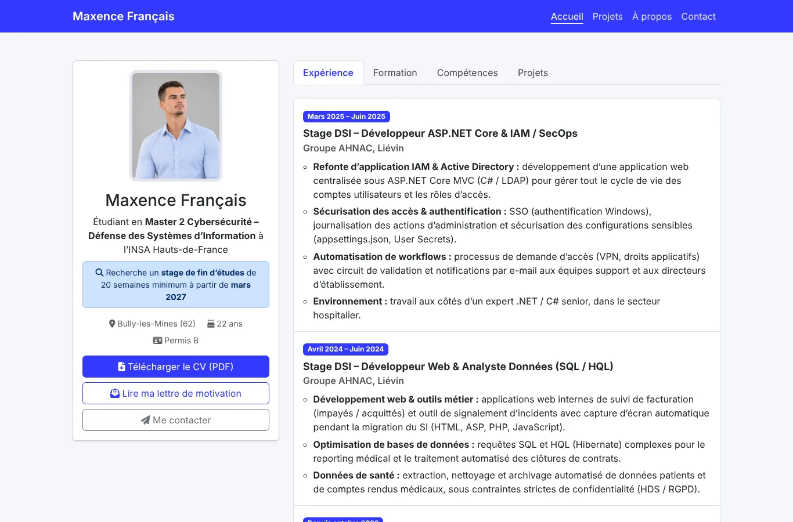

# Portfolio Bootstrap – Maxence Français

La première version de mon portfolio, codée à la main en HTML, CSS, Bootstrap 5 et JavaScript, sans framework ni générateur de site. Elle reste en ligne sur [miscuitatlas.github.io/portfolio-bootstrap](https://miscuitatlas.github.io/portfolio-bootstrap/).

> Ce site n'est plus mis à jour. Mon portfolio actuel est sur [miscuitatlas.github.io](https://miscuitatlas.github.io) (dépôt [MiscuitAtlas.github.io](https://github.com/MiscuitAtlas/MiscuitAtlas.github.io)).



## Contenu

- **Accueil** : présentation, recherche de stage, CV en PDF et lettre de motivation.
- **Parcours, compétences et projets** : une carte par projet, avec des captures d'écran, le lien vers le code et vers la démo.
- **À propos** : les choix techniques et la sécurité du site.
- **Contact** : formulaire relié à [Formspree](https://formspree.io/), avec un champ piège contre le spam.

**Stack** : HTML5, CSS3, Bootstrap 5.3, Font Awesome 6, JavaScript sans bibliothèque, Formspree, GitHub Pages.

## Sécurité

- Content Security Policy stricte : aucun script ni style écrit dans les pages, seuls le site et jsDelivr peuvent fournir du code.
- Subresource Integrity (SRI) sur Bootstrap et Font Awesome : le navigateur vérifie leur empreinte avant de les exécuter.
- Le contact passe par le formulaire : mon numéro de téléphone et mon email ne figurent que dans le CV.

## Lancer le site en local

La barre de navigation et le pied de page sont chargés avec `fetch()`, que le navigateur bloque quand on ouvre `index.html` par double-clic. Il faut donc passer par un petit serveur :

```bash
git clone https://github.com/MiscuitAtlas/portfolio-bootstrap.git
cd portfolio-bootstrap
python -m http.server 8000     # http://localhost:8000
```

## Structure

```
index.html      accueil : profil, parcours, compétences, projets, lettre de motivation
a-propos.html   choix techniques et sécurité du site
contact.html    formulaire de contact
partials/       barre de navigation et pied de page communs
css/, js/       styles, chargement des parties communes, galerie, onglets
assets/         images (WebP) et CV
```

## Auteur

**Maxence Français** : [portfolio actuel](https://miscuitatlas.github.io) · [LinkedIn](https://www.linkedin.com/in/maxence-fran%C3%A7ais-a039a2307/)
